# I am (IN) stickers — 53 stickers that replace the emojis in the app UI

Boards: `sticker-board-dark.jpg`, `sticker-board-light.jpg`.
Files: `png/<id>.png` (300×300, transparent, white die-cut outline + shadow — ready for the app),
`svg/<id>.svg` (vector; the outline is an SVG filter, text uses Anton / Inter Tight / JetBrains Mono).
Source: `source/stickers.js` (all drawings + the mapping below), `source/board.html`, `source/shoot.mjs`.

## Rules
- No emojis in app chrome: tabs, headers, buttons, badges, chips, toasts, empty states, notifications.
- Emojis people type stay: chat, notes, captions, comments, Cover Studio "type any emoji".
- Stickers pop in with a small bounce (scale 0.6 → 1.08 → 1, ~250 ms) and a light haptic.
- Avatar without a photo: initials in Anton on a sticker colour (lime, pink, blue, yellow, orange) instead of `lib/avatarEmoji.tsx`.
- Line mode 🟢🟡🔴⛔: plain coloured dots + a word. Functional emojis (🔗 💳 🌐 🚫 🔔 📝 👁️ ⚠️, arrows) → line icons or text.

## Moods (Your mood today) & status on avatars

| Sticker | Use | Replaces | Where in the code |
|---|---|---|---|
| 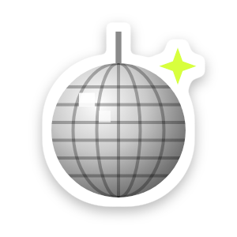 `disco` | Out tonight | 🔥 🪩 | OutTonightBar vibe_out |
| 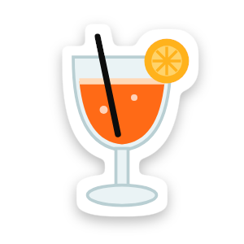 `spritz` | Drinks | 🍸 🍹 | vibe_drinks |
| 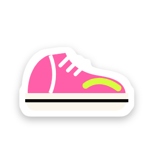 `sneaker` | Dancing | 💃 | vibe_dancing |
| 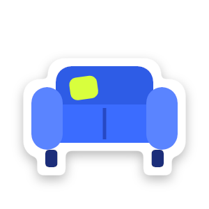 `couch` | Chill hang / still home | 🛋️ | vibe_chill, LiveRadar |
| 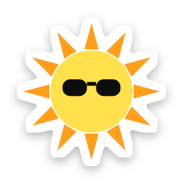 `sun` | Day event / sunny | ☀️ | vibe_day, CoverStudio |
| 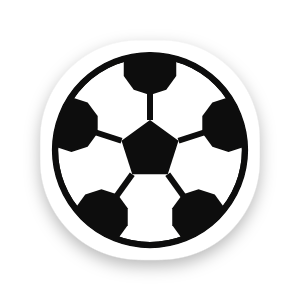 `ball` | Sport | ⚡ ⚽ | vibe_sport, categories |
| 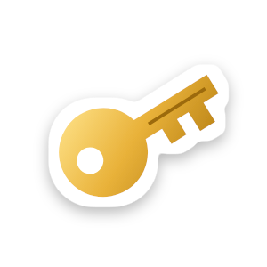 `key` | At mine | 🏠 | new mood |
|  `free` | Free tonight | 🟢 | StatusBadge available |
| 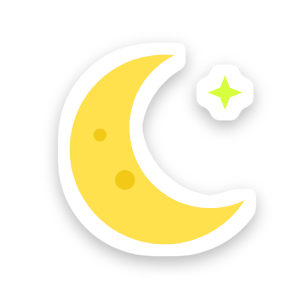 `moon` | Not tonight / late | 🌙 | StatusBadge, PactSection |
| 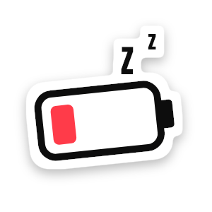 `battery` | Low energy | 😴 | StatusBadge, StatusSheet |

## Reactions, exit poll & scores

| Sticker | Use | Replaces | Where in the code |
|---|---|---|---|
| 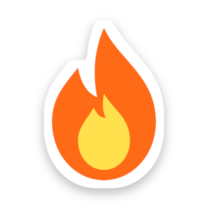 `flame` | Fire / worth it | 🔥 | ReactionPicker, ExitPoll, EventScoreStrip |
| 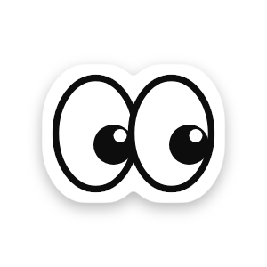 `eyes` | Looking / are you in? | 👀 | ReactionPicker, reality check |
| 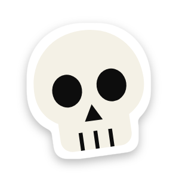 `skull` | Dead / flop | 💀 | ReactionPicker, ExitPoll |
| 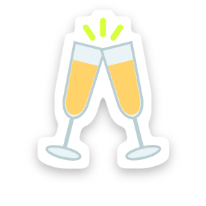 `cheers` | Cheers / brunch | 🥂 | ReactionPicker, categories |
| 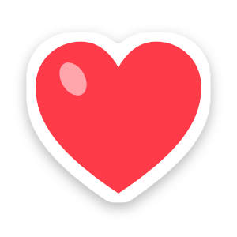 `heart` | Love | ❤️ 💖 💜 | ReactionPicker, cards |
| 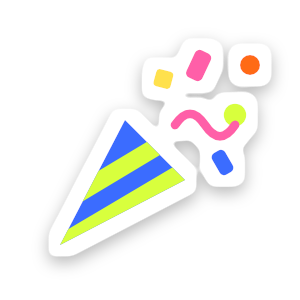 `popper` | Party | 🎉 🥳 🎊 | ReactionPicker, categories, toasts |
| 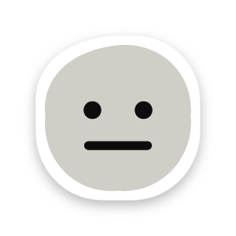 `meh` | Mid | 😐 | ExitPoll, EventScoreStrip |
| 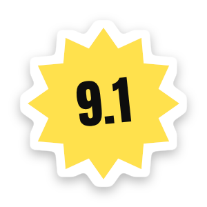 `burst` | Score (number on top) | ★ ⭐ 🏅 | NightReceipt, CreatorScore |
| 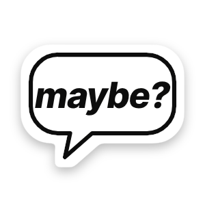 `maybe` | Maybe | 🤔 🤷 | Maybe states |
| 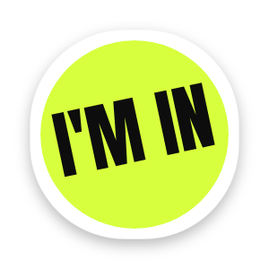 `in` | I'm in / confirmed | ✅ ✋ | RSVP, EventPulse, notifications |

## Event categories

| Sticker | Use | Replaces | Where in the code |
|---|---|---|---|
| 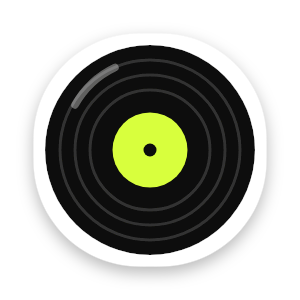 `vinyl` | Music | 🎵 🎶 | FilterSheet, EventCard, AddEvent |
|  `popper` | Party | 🎉 | FilterSheet |
| 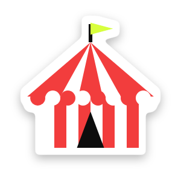 `tent` | Festival | 🎪 | FilterSheet |
| 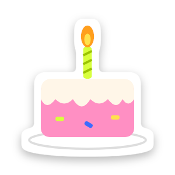 `cake` | Birthday | 🎂 | FilterSheet, birthdays |
| 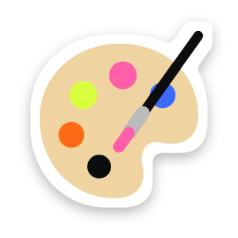 `palette` | Art | 🎨 | FilterSheet |
| 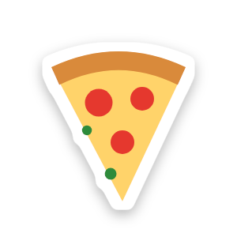 `pizza` | Food | 🍽️ 🌮 | FilterSheet |
| 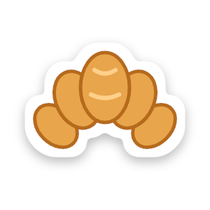 `croissant` | Brunch | 🥂 ☕ | FilterSheet |
| 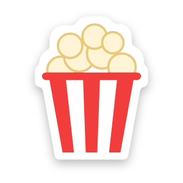 `popcorn` | Cinema | 🎬 | FilterSheet |
|  `ball` | Sports | ⚡ | FilterSheet |
| 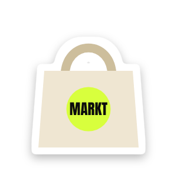 `tote` | Street markets | 🛍️ | FilterSheet |

## On the night: radar, pacts, ghosts, the line, the tab

| Sticker | Use | Replaces | Where in the code |
|---|---|---|---|
| 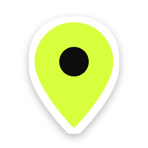 `pin` | I'm there / location | 📍 🎉 | LiveRadar, EventDetail |
| 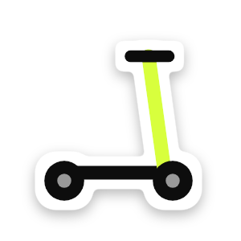 `scooter` | On the way | 🛵 🚶 | LiveRadar |
| 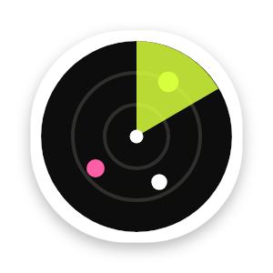 `radar` | Live radar | 📡 | LiveRadarSection, MapSheet |
|  `seal` | Pact sealed | 🤝 | PactSection, notifications |
| 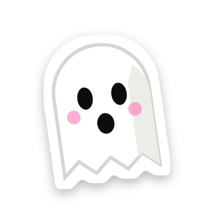 `ghost` | Ghost / let it fade / knock | 👻 | EventPulse, GhostKnock, FriendGhostCard |
| 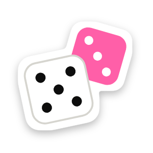 `dice` | Roulette | 🎲 | Roulette sheet |
| 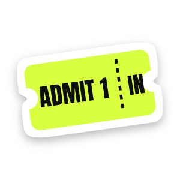 `ticket` | Walk-in / the line | 🟢 🎟️ | Line mode, notifications |
| 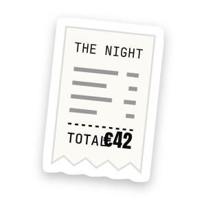 `receipt` | The tab / receipt | 🧾 | NightReceipt, expenses |
| 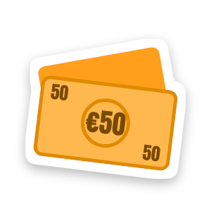 `cash` | Paid / money | 💸 💳 | payments, Onboarding |

## Capsule & memories

| Sticker | Use | Replaces | Where in the code |
|---|---|---|---|
| 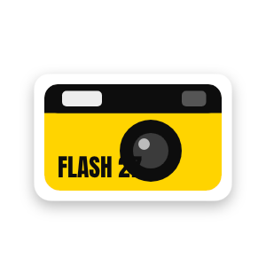 `cam` | Capsule / photos | 📸 | TimeCapsule, AddEvent |
| 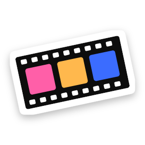 `film` | Recap / reel | 🎞️ | CapsuleDetail |
|  `crystal` | Prediction | 🔮 | RevealedPredictions, TimeCapsule |
| 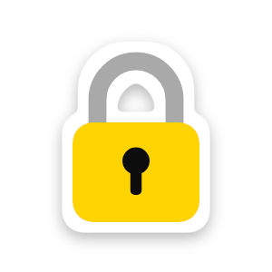 `lock` | Sealed / private | 🔒 | EventDetail, capsules |
| 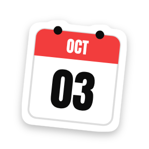 `calendar` | Date / plans | 🗓️ 📅 | calendar, notifications |

## Birthdays

| Sticker | Use | Replaces | Where in the code |
|---|---|---|---|
|  `cake` | Birthday | 🎂 🍰 | BirthdayCardComposer/Reveal |
| 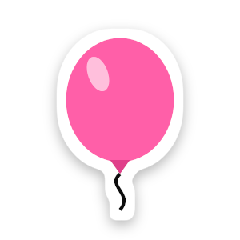 `balloon` | Balloon | 🎈 | Birthday cards |
| 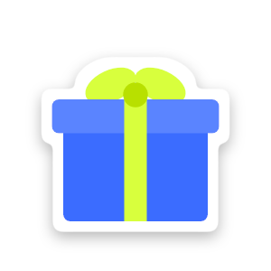 `gift` | Gift | 🎁 | Birthday cards, ConvertMaybes |
| 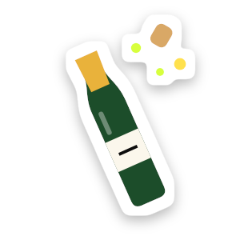 `bottle` | Bubbles | 🍾 | Birthday cards |
| 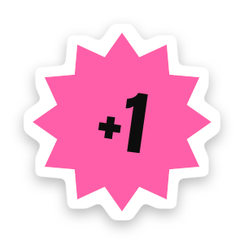 `plus1` | +1 / party | 🥳 🎊 | Birthday cards, calendar |

## Notifications & everything else

| Sticker | Use | Replaces | Where in the code |
|---|---|---|---|
| 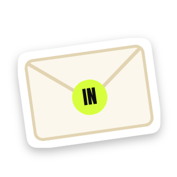 `envelope` | Invite | 💌 | NotificationsBell, Calendar |
| 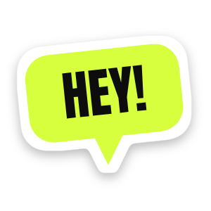 `hey` | Friend request / wave | 👋 | NotificationsBell, Welcome, Onboarding |
| 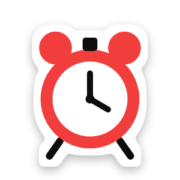 `clock` | Reminder | ⏰ | payment_reminder |
|  `spark` | New / glow | ✨ ✦ 💫 🌟 | new_follower, toasts, CoverStudio |
| 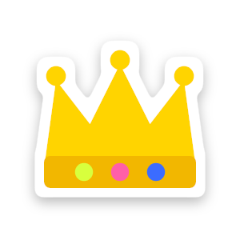 `crown` | Super host | 👑 | organizer SuperHostsCard |
| 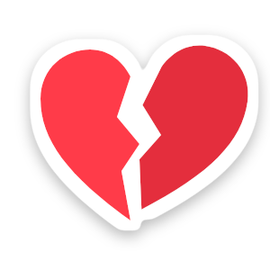 `brokenheart` | Slipping away | 💔 | organizer SlippingAwayCard |
|  `wave` | Chill / pool | 🌊 🌴 | CoverStudio presets |